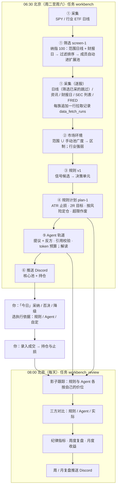

# 系统架构

> 版本 v2.0.0（2026-10-25）。只做美股；系统出计划，人决定是否下单，不接券商、不自动下单。
> 本文写到模块级。每个功能怎么用、怎么验证见 `features/`；怎么运行和维护见 `operations/`。

---

## 1. 运行形态：一个进程 + 一个数据库

```
macOS LaunchAgent（local.investment-assistant，登录时启动，KeepAlive）
  └─ start.command → scripts/start_local.py → uvicorn 127.0.0.1:8787（单进程）
       ├─ FastAPI：/api/*（OpenAPI 在 /docs）
       ├─ 静态前端：web/dist（Svelte 5，单页应用）
       └─ 调度线程：每 60 秒轮询 scheduled_jobs，到点运行已注册任务
PostgreSQL：唯一的状态存储（调度、运行报告、行情、计划、成交、复盘）
```

外部依赖与缺失时的行为：

| 依赖 | 用途 | 缺失或失败时 |
| --- | --- | --- |
| yfinance | 日线、资讯标题、下次财报日 | 单只股票的单个数据源失败只记入运行报告 `summary.sources`，不写库、不冒充「无信号」 |
| SEC EDGAR（`SEC_USER_AGENT`） | 8-K/10-Q/10-K 列表与下载、SEC 监控 | 列表失败记入运行报告；缺 `SEC_USER_AGENT` 时下载返回空 |
| FRED（`FRED_API_KEY`） | HY 信用利差、2s10s | 未配置记「未配置」，不发请求 |
| 智谱（`ZHIPU_API_KEY`） | Agent 轨道 | Agent 轨道停下并记原因，规则轨道照常推送 |
| Discord | 每日计划推送、周/月复盘推送、SEC 监控通知 | 推送失败写入运行报告，下次推送附「上次推送失败」 |
| PostgreSQL（`INVESTMENT_ASSISTANT_DATABASE_URL`） | 全部状态 | 大多数接口返回 `degraded` 或 503，调度线程不启动 |

---

## 2. 代码分层

```
api/routes/*      HTTP 薄封装：解析参数、映射错误码，不写业务逻辑
   ↓
services/*、workbench/service.py      事务与用例
   ↓
workbench/repository.py、us_research/repository.py、db.py      SQL（调用方管理事务）
tasks/*           定时任务入口，统一走 tasks/_harness.py（run_id、运行报告、通知）
```

工作台的规则、计划、影子跟踪、纪律、月度收益和三方对比都写成**纯函数**（输入是截止时间之前的数据，输出是记录），离线测试不需要数据库。

### 主线模块（v2 工作台）

| 模块 | 做什么 | 依赖 |
| --- | --- | --- |
| `workbench/service.py` | 批处理编排（采集 → 筛选 → 环境 → 规则 → 计划 → Agent → 推送）与全部用例 | 下列模块、`repository` |
| `workbench/repository.py` | 工作台全部 SQL，只追加 | `db.py` |
| `workbench/bars.py`、`news.py`、`earnings.py`、`macro.py` | 采集：日线、资讯标题、财报日、FRED | yfinance、SEC、FRED |
| `workbench/universe.py`、`screen.py` | 纳指 100 范围文件；`screen-1` 过滤、排序、成员轮换（纯函数） | 纯函数 |
| `workbench/screening.py` | 筛选阶段编排：采集范围日线、写 `screen_runs` / `screen_results`、成员并池 | `service`、`repository` |
| `workbench/collect.py` | 共用逐只采集函数（批处理、筛选与「数据」菜单手动拉取共用）、`Tally` 记账与每族 advisory lock | `service`、采集模块 |
| `workbench/stages.py` | 七个阶段注册表（`stages-1`）与 `StageRecorder`：批处理每阶段一行 `stage_runs` 证据（计数、原因、产出引用、耗时） | `families`、`collect`、`repository` |
| `workbench/families.py` | 六个数据族注册表：用途、状态判定、原因脱敏、覆盖口径、目标清单（目标清单读数据库与范围文件，其余为纯函数） | `repository`、`pool`、`universe` |
| `workbench/pool.py`、`regime.py` | 观察池分层与来源；范围 ∪ 手动池的广度、区制、行业强弱 | 纯函数 |
| `workbench/rules.py`、`synthesis.py` | 规则 v1 候选；合成每股每日一个决策单元 | 纯函数 |
| `workbench/plans.py` | ATR、计划价位、有效期、财报提示、按风险定仓 | 纯函数 |
| `workbench/derivation.py` | 计划推导链（`derivation-1`）：按代入值独立重算 `plan-1` 规则计划的每一步（TR、ATR、价位、有效期、财报与环境提示、定仓、状态），与已存值逐项比对，给出 `consistent` / `mismatch` / `incomplete`；自定计划（价位为用户输入）与 Agent 计划（价位核对 `agent_runs.output.levels`）按入场区间中点定仓；触发段 `derive_trigger` / `derive_unit` 按 `CONDITIONS` 逐句复核候选冻结的取值（`holds` / `violated` / `not_frozen`，`violated` 计入不一致）；常量与 `plans.py` 分开声明、由测试对齐；不调用 `plans.py` 的计算函数 | 纯函数（只依赖交易日历） |
| `workbench/agent/` | Agent 轨道：工具层、LangGraph 图（提议 + 反方 / 解读）、引用校验、模型接入 | LangGraph、智谱、PostgresSaver |
| `workbench/briefs.py` | 由 Agent 运行构造决策单元的解读 | 纯函数 |
| `workbench/ledger.py`、`positions.py`、`exits.py`、`account.py` | 决定与成交（只追加）、FIFO 持仓、持仓止损、资金快照与出入金 | 纯函数 + SQL |
| `workbench/plan_shadow.py`、`review.py`、`discipline.py`、`tracks.py`、`monthly.py`、`backcheck.py` | 影子跟踪、周度复盘、纪律、三方对比、月度收益与敏感性、上线前检查 | 纯函数 |
| `workbench/digest.py`、`review_digest.py` | 每日推送与周/月复盘推送的数据 | 纯函数 |
| `workbench/data_view.py` | 「数据」菜单用例：总览 / 详情 / 浏览（只读事务）与单族手动拉取，写 `data_fetch_runs` | `families`、`collect`、`repository`、`runner` |
| `tasks/workbench.py`、`tasks/workbench_review.py` | 两个定时任务入口 | `workbench/service.py` |

### 共享底座

| 模块 | 做什么 |
| --- | --- |
| `api/` | FastAPI 应用、Basic 认证、静态文件、路由 |
| `tasks/scheduler.py`、`tasks/_harness.py`、`tasks/runner.py`、`tasks/run_log.py` | 调度线程、任务外壳、手动运行的后台执行、运行日志（JSONL） |
| `notify/` | Discord（webhook 与 Bot）与邮件渠道、消息模板 |
| `filings/` | SEC 下载器与 SEC 监控（正文事实、来源报告、历史去重） |
| `data/` | 交易日历、HTTP 重试、美股代码校验（`identity.py`） |
| `services/watchlist.py`、`settings.py`、`jobs.py`、`status.py`、`health.py` | 观察名单（只认美股代码）、通知设置、任务与运行报告、系统状态 |
| `db.py`、`migrate.py`、`config.py` | 连接池与通用 SQL、迁移入口、配置加载 |

### 主线 · 基本面

| 模块 | 做什么 |
| --- | --- |
| `us_research/` | 美股财季数据与指引（「标的 → 基本面」、SEC 任务后的本地刷新） |

---

## 3. 主线数据流



时点纪律：规则、计划和 Agent 工具只读运行截止时间之前已入库的数据；所有业务记录只追加，更正用新记录指向旧记录。手动运行批处理不推送。

---

## 4. 数据表分组

| 组 | 表 |
| --- | --- |
| 共享底座 | `watchlist_items`、`scheduled_jobs`、`job_reports`、`notify_settings`、`filings` |
| 数据底座 | `data_fetch_runs`（迁移 024，只追加：每次拉取一行成败与逐只原因，批处理、`filings` 任务与「数据」菜单共用）、`stage_runs`（迁移 025，只追加：每次 workbench 运行每阶段一行证据，含计数、原因、产出引用与耗时） |
| 工作台 · 采集 | `price_bars`、`news_items`、`news_item_tickers`、`earnings_dates`、`macro_observations` |
| 工作台 · 信号与筛选 | `signal_candidates`、`signal_briefs`、`pool_tiers`（含 `source`）、`market_regimes`、`screen_runs`、`screen_results` |
| 工作台 · 计划与执行 | `trade_plans`、`signal_decisions`、`trades`、`account_snapshots`、`cash_flows` |
| 工作台 · Agent | `agent_runs`、`agent_tool_calls`；LangGraph 检查点表由 `python -m investment_assistant.workbench.agent setup` 创建，不在迁移里 |
| 工作台 · 复盘 | `weekly_reviews`、`monthly_reviews`、`rule_backchecks`、`review_pushes` |
| 主线 · 基本面 | `us_research_observations`、`us_research_collection_state`（`us_research/`；迁移 022 删除 v1 遗留的 6 张表，见 operations） |

迁移清单与执行方式见 [operations/migrations-and-backup.md](operations/migrations-and-backup.md)。

---

## 5. 定时任务与前端

| 任务 | 默认时间（迁移种子） | 组 |
| --- | --- | --- |
| `workbench` | 北京 06:30，周二至周六 | 主线 |
| `workbench_review` | 北京 08:00，每天（迁移插入为关闭） | 主线 |
| `filings` | 北京 09:30，周一至周五 | 共享 |

调度细节见 [operations/scheduling-and-notifications.md](operations/scheduling-and-notifications.md)。

前端（`web/`，Svelte 5）：主线入口是「今日」「标的」（K 线图与基本面）「复盘」（交易与持仓、对照组、周度、月度、资金、轨道对比、上线前检查）；「数据」展示六族状态、族详情与原始值表格；「更多」下是共享底座的「工具」（任务中心、运行记录、SEC 文件）与「设置」（系统、关注列表、推送、定时任务、环境变量）。旧地址（#technicals、#strategy、#trade）回落到「今日」。
