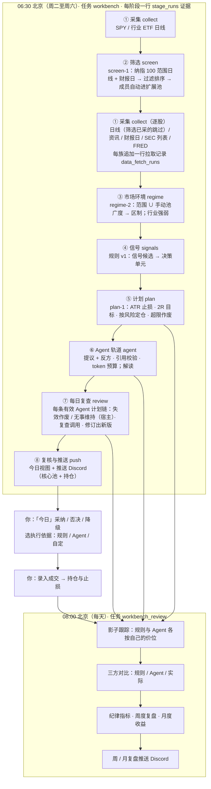

# 系统架构

> 版本 v2.0.0（2026-10-25）。只做美股；系统出计划，人决定是否下单，不接券商、不自动下单。
> 本文写到模块级。每个功能怎么用、怎么验证见 `features/`；怎么运行和维护见 `operations/`。

---

## 1. 运行形态：一个进程 + 一个数据库

```
macOS LaunchAgent（local.investment-assistant，登录时启动，KeepAlive）
  └─ start.command → scripts/start_local.py → uvicorn 127.0.0.1:8787（单进程）
       ├─ FastAPI：/api/*（OpenAPI 在 /docs）
       ├─ 静态前端：web/dist（Svelte 5，单页应用）
       └─ 调度线程：每 60 秒轮询 scheduled_jobs，到点运行已注册任务
PostgreSQL：唯一的状态存储（调度、运行报告、行情、计划、成交、复盘）
```

外部依赖与缺失时的行为：

| 依赖 | 用途 | 缺失或失败时 |
| --- | --- | --- |
| yfinance | 日线、资讯标题、下次财报日 | 单只股票的单个数据源失败只记入运行报告 `summary.sources`，不写库、不冒充「无信号」 |
| SEC EDGAR（`SEC_USER_AGENT`） | 8-K/10-Q/10-K 列表与下载、SEC 监控 | 列表失败记入运行报告；缺 `SEC_USER_AGENT` 时下载返回空 |
| FRED（`FRED_API_KEY`） | HY 信用利差、2s10s | 未配置记「未配置」，不发请求 |
| 智谱（`ZHIPU_API_KEY`） | Agent 轨道 | Agent 轨道停下并记原因，规则轨道照常推送 |
| Discord | 每日计划推送、周/月复盘推送、SEC 监控通知 | 推送失败写入运行报告，下次推送附「上次推送失败」 |
| PostgreSQL（`INVESTMENT_ASSISTANT_DATABASE_URL`） | 全部状态 | 大多数接口返回 `degraded` 或 503，调度线程不启动 |

---

## 2. 代码分层

```
api/routes/*      HTTP 薄封装：解析参数、映射错误码，不写业务逻辑
   ↓
services/*、workbench/service.py、workbench/plan_review.py      事务与用例
   ↓
workbench/repository.py、us_research/repository.py、db.py      SQL（调用方管理事务）
tasks/*           定时任务入口，统一走 tasks/_harness.py（run_id、运行报告、通知）
```

工作台的规则、计划、影子跟踪、纪律、月度收益和三方对比都写成**纯函数**（输入是截止时间之前的数据，输出是记录），离线测试不需要数据库。

### 主线模块（v2 工作台）

| 模块 | 做什么 | 依赖 |
| --- | --- | --- |
| `workbench/service.py` | 批处理编排（采集 → 筛选 → 环境 → 规则 → 计划 → Agent → 每日复查 → 推送）与全部用例 | 下列模块、`repository` |
| `workbench/repository.py` | 工作台全部 SQL，只追加 | `db.py` |
| `workbench/bars.py`、`news.py`、`earnings.py`、`macro.py` | 采集：日线、资讯标题、财报日、FRED | yfinance、SEC、FRED |
| `workbench/universe.py`、`screen.py` | 纳指 100 范围文件；`screen-1` 过滤、排序、成员轮换（纯函数） | 纯函数 |
| `workbench/screening.py` | 筛选阶段编排：采集范围日线、写 `screen_runs` / `screen_results`、成员并池 | `service`、`repository` |
| `workbench/collect.py` | 共用逐只采集函数（批处理、筛选与「数据」菜单手动拉取共用）、`Tally` 记账与每族 advisory lock | `service`、采集模块 |
| `workbench/stages.py` | 八个阶段注册表（`stages-2`；迁移 026 未执行时按 `stages-1` 的七个阶段记账）与 `StageRecorder`：批处理每阶段一行 `stage_runs` 证据（计数、原因、产出引用、耗时） | `families`、`collect`、`repository` |
| `workbench/families.py` | 六个数据族注册表：用途、状态判定、原因脱敏、覆盖口径、目标清单（目标清单读数据库与范围文件，其余为纯函数） | `repository`、`pool`、`universe` |
| `workbench/pool.py`、`regime.py` | 观察池分层与来源；范围 ∪ 手动池的广度、区制、行业强弱 | 纯函数 |
| `workbench/rules.py`、`synthesis.py` | 规则 v1 候选；合成每股每日一个决策单元 | 纯函数 |
| `workbench/plans.py` | ATR、计划价位、有效期、财报提示、按风险定仓 | 纯函数 |
| `workbench/derivation.py` | 计划推导链（`derivation-1`）：按代入值独立重算 `plan-1` 规则计划的每一步（TR、ATR、价位、有效期、财报与环境提示、定仓、状态），与已存值逐项比对，给出 `consistent` / `mismatch` / `incomplete`；自定计划（价位为用户输入）与 Agent 计划（价位核对 `agent_runs.output.levels`）按入场区间中点定仓；触发段 `derive_trigger` / `derive_unit` 按 `CONDITIONS` 逐句复核候选冻结的取值（`holds` / `violated` / `not_frozen`，`violated` 计入不一致）；常量与 `plans.py` 分开声明、由测试对齐；不调用 `plans.py` 的计算函数 | 纯函数（只依赖交易日历） |
| `workbench/derivation_view.py` | 推导与阶段证据的只读用例：`load_rows` 只按计划 `inputs` 里的 id 回读日线、财报日、快照、区制、Agent 运行与规则计划（都是只追加的表，读到的就是生成时那一行）；`plan_derivation`（推导 + `trigger_note` + 运行证据 `run`，运行证据取插入该计划的 `plan` / `agent` 阶段行）、`unit_derivation`（只有触发段 + 该单元计划 id）、`stage_runs_view`（按 `run_id` 分组、按注册表排序）、`check_plans`（批处理用，同一只读事务里批量推导）；全部在 `service.read_only_tx()` 里执行，不调用外部数据源，缺行如实标 `incomplete` | `derivation`、`stages`、`repository`、`service` |
| `workbench/knowledge.py` | 版本化概念卡与「原理」页（v2.6，`knowledge-1`）：读 `docs/knowledge/` 的 Markdown 卡（YAML 头 + 正文），一次报出全部校验问题，用 `markdown-it-py` 渲染（关闭原始 HTML、卡内链接在 token 层改写），给 Agent 的纯文本，进程内缓存（失败不缓存）；知识接口、`get_concept` 与命令行 `check` / `show` 共用；纯文件读取，不碰数据库 | `markdown-it-py`、`PyYAML`、`stages`（阶段 id） |
| `workbench/labels.py` | 规则中文名（全称 `RULE_TEXT`、K 线标记用的简称 `RULE_SHORT`）与动作名；运行一览、「今天该关注什么」与 K 线标注共用，前端 `RULE_LABELS` 与之逐字对齐 | 无 |
| `workbench/run_overview.py` | 运行一览（v2.6）：只读 `stage_runs`，按模板拼每个阶段的一句话与原因文案（纯函数 `describe` / `build`，数字与行逐字段相同），选同日要显示的那次运行（跳过休市空跑）；只读用例 `overview`（`service.read_only_tx()`）与命令行 `python -m investment_assistant.workbench.run_overview` | `stages`、`labels`、`agent`（原因文案）、`repository`、`service` |
| `workbench/reasoning.py` | Agent 推理阅读视图（v2.6）：把一次 Agent 运行（`propose` / `revise` / `review` / `interpret`）按阅读步骤摊开——读了什么、提议、校验、反方、回应、生成的计划；`TOOL_CONCEPTS`（工具结果字段 → 概念卡）、`CHECKS`（校验项与作废原因）；纯函数 `build` 与只读用例 `reasoning`（同一只读事务里复用 `derivation_view` 的推导） | `agent/conditions`、`labels`、`derivation_view`、`repository`、`service` |
| `workbench/chart.py` | 「标的」页的 K 线数据：拆股调整日线（保留 250 根，MA20 / 50 / 200 用全部读到的历史算）；v2.6 起 `annotate`（纯函数）从已有表组装图上标注——候选信号日的箭头（同日多条合成一条，文字取 `labels.RULE_SHORT`）、每份计划在有效期与图上日期交集内的入场上沿 / 下沿 / 止损 / T1 四条短线段（有效期最近的 `MAX_PLANS = 12` 份，其余记 `omitted`）、你的未作废成交（落在纽约日期那根日线，非交易日落到之后最近一根），标记按时间升序 | `labels` |
| `workbench/instrument_view.py` | 「标的」页的纯函数（v2.6）：「今天该关注什么」`focus`（持仓 → 进行中的 Agent 计划 → 今日触发 → 临近财报）、`key_data`（与 Agent 工具同一个 `tools.indicators`，请求时现算不入库）、`context_view`（下次财报日、区制、行业强弱） | `agent/tools`、`reasoning`、`labels` |
| `workbench/agent/` | Agent 轨道：工具层（九个工具，含不受截止时间约束的 `get_concept`）、LangGraph 图（提议 + 反方 / 解读）、引用校验、模型接入 | LangGraph、智谱、PostgresSaver |
| `workbench/agent/conditions.py` | 失效条件与下次复查条件的注册表 `condition-1`：参数校验、按事实判定 `met` / `not_met` / `unknown`（数据缺失不当作成立）、条件文案 | 纯函数（只依赖交易日历） |
| `workbench/agent/plan_check.py` | `agent-2` 计划、反证与复查结论的校验（论点条数、条件、修订 `changes` 与宿主差异、`user:<id>` 引用），宿主差异 `diff` | `citations`、`conditions` |
| `workbench/timeline.py` | 计划时间线 `timeline-1`：链状态、版本有效期与版本计划行、「上次复查之后」窗口、七项系统信号、条件判定结果、宿主结论（失效作废 / 无事维持）、截止时间之前的有效用户输入、复查与修订提示词的证据块 | 纯函数（复用 `plans` 的计算函数） |
| `workbench/plan_review.py` | 每日复查阶段 `review`：复查对象与排序、链标的（只采集不跑规则）、逐链复查 `review_chain`（全程在一条不经连接池的专用连接（autocommit，用完即关）上持会话级锁 `review-run:<标的>:<信号日>`；短事务持锁读取 → 无事务调模型 → 一个写事务写入复查运行、修订运行、新版计划与版本、复查记录）、阶段记账（含逐链 `detail.excluded`）与新版推导核对；重新复查（`recheck_check` 同步前置检查、`recheck` 后台执行，截止时间 = 请求时刻）；只读视图（链视图 `chain_view`、某日复查 `reviews_view`、标的的链列表 `ticker_chains`）；命令行 `python -m investment_assistant.workbench.plan_review chain / recheck / check` | `service`、`timeline`、`user_inputs`、`agent/`、`repository` |
| `workbench/user_inputs.py` | 用户输入（研报要点、新闻、你的判断、其他、撤回）：校验、按 `request_id` 幂等写入（只追加，更正与撤回指向旧行）、按标的 / 链列出并标记已更正 / 已撤回；只作为复查与修订提示词的证据 | `ledger`（`request_hash`）、`repository` |
| `workbench/briefs.py` | 由 Agent 运行构造决策单元的解读 | 纯函数 |
| `workbench/ledger.py`、`positions.py`、`exits.py`、`account.py` | 决定与成交（只追加）、FIFO 持仓、持仓止损、资金快照与出入金 | 纯函数 + SQL |
| `workbench/plan_shadow.py`、`review.py`、`discipline.py`、`tracks.py`、`monthly.py`、`backcheck.py` | 影子跟踪、周度复盘、纪律、三方对比、月度收益与敏感性、上线前检查 | 纯函数 |
| `workbench/digest.py`、`review_digest.py` | 每日推送与周/月复盘推送的数据 | 纯函数 |
| `workbench/data_view.py` | 「数据」菜单用例：总览 / 详情 / 浏览（只读事务）与单族手动拉取，写 `data_fetch_runs` | `families`、`collect`、`repository`、`runner` |
| `tasks/workbench.py`、`tasks/workbench_review.py` | 两个定时任务入口 | `workbench/service.py` |

### 共享底座

| 模块 | 做什么 |
| --- | --- |
| `api/` | FastAPI 应用、Basic 认证、静态文件、路由 |
| `tasks/scheduler.py`、`tasks/_harness.py`、`tasks/runner.py`、`tasks/run_log.py` | 调度线程、任务外壳、手动运行的后台执行、运行日志（JSONL） |
| `notify/` | Discord（webhook 与 Bot）与邮件渠道、消息模板 |
| `filings/` | SEC 下载器与 SEC 监控（正文事实、来源报告、历史去重） |
| `data/` | 交易日历、HTTP 重试、美股代码校验（`identity.py`） |
| `services/watchlist.py`、`settings.py`、`jobs.py`、`status.py`、`health.py` | 观察名单（只认美股代码）、通知设置、任务与运行报告、系统状态 |
| `db.py`、`migrate.py`、`config.py` | 连接池与通用 SQL、迁移入口、配置加载 |

### 主线 · 基本面

| 模块 | 做什么 |
| --- | --- |
| `us_research/` | 美股财季数据与指引（「标的 → 基本面」、SEC 任务后的本地刷新） |

---

## 3. 主线数据流



时点纪律：规则、计划和 Agent 工具只读运行截止时间之前已入库的数据；所有业务记录只追加，更正用新记录指向旧记录。手动运行批处理不推送。

八个阶段（`collect`、`screen`、`regime`、`signals`、`plan`、`agent`、`review`、`push`）按 `workbench/stages.py` 注册表（`stages-2`）的定义展示，每次运行每阶段向 `stage_runs` 追加一行证据（计数、原因、产出引用、耗时）；迁移 026 未执行时本次按 `stages-1` 记七个阶段（没有 `review`）。`review` 只复查已有的 `agent-2` 链；链的标的若已离开观察池与持仓，只在采集阶段补采数据，不进规则循环。`collect` 的时间窗口包住 `screen`（筛选自己采集范围日线，这部分记在 `collect` 的 `bars` 计数里），信号与计划在同一个逐只循环里交替执行；展示顺序以注册表为准，不以时间戳为准。

---

## 4. 数据表分组

| 组 | 表 |
| --- | --- |
| 共享底座 | `watchlist_items`、`scheduled_jobs`、`job_reports`、`notify_settings`、`filings` |
| 数据底座 | `data_fetch_runs`（迁移 024，只追加：每次拉取一行成败与逐只原因，批处理、`filings` 任务与「数据」菜单共用）、`stage_runs`（迁移 025，只追加：每次 workbench 运行每阶段一行证据，含计数、原因、产出引用与耗时） |
| 工作台 · 采集 | `price_bars`、`news_items`、`news_item_tickers`、`earnings_dates`、`macro_observations` |
| 工作台 · 信号与筛选 | `signal_candidates`、`signal_briefs`、`pool_tiers`（含 `source`）、`market_regimes`、`screen_runs`、`screen_results` |
| 工作台 · 计划与执行 | `trade_plans`、`signal_decisions`、`trades`、`account_snapshots`、`cash_flows` |
| 工作台 · Agent | `agent_runs`、`agent_tool_calls`；LangGraph 检查点表由 `python -m investment_assistant.workbench.agent setup` 创建，不在迁移里 |
| 工作台 · 计划时间线 | `agent_plan_versions`（每版 Agent 计划一行，链关系与截止时间）、`plan_reviews`（每次复查一行：信号、条件判定、结论、新版）、`user_inputs`（你贴入的材料，更正与撤回指向旧行）；迁移 026，只追加，不在 `WORKBENCH_TABLES` 里，缺表时按 `timeline_ready` 降级 |
| 工作台 · 复盘 | `weekly_reviews`、`monthly_reviews`、`rule_backchecks`、`review_pushes` |
| 主线 · 基本面 | `us_research_observations`、`us_research_collection_state`（`us_research/`；迁移 022 删除 v1 遗留的 6 张表，见 operations） |

迁移清单与执行方式见 [operations/migrations-and-backup.md](operations/migrations-and-backup.md)。

---

## 5. 定时任务与前端

| 任务 | 默认时间（迁移种子） | 组 |
| --- | --- | --- |
| `workbench` | 北京 06:30，周二至周六 | 主线 |
| `workbench_review` | 北京 08:00，每天（迁移插入为关闭） | 主线 |
| `filings` | 北京 09:30，周一至周五 | 共享 |

调度细节见 [operations/scheduling-and-notifications.md](operations/scheduling-and-notifications.md)。

前端（`web/`，Svelte 5）：主线入口是「今日」「标的」（K 线图与基本面）「复盘」（交易与持仓、对照组、周度、月度、资金、轨道对比、上线前检查）；「数据」展示六族状态、族详情与原始值表格；「更多」下是共享底座的「工具」（任务中心、运行记录、SEC 文件）与「设置」（系统、关注列表、推送、定时任务、环境变量）。计划推导整页地址 `#plan/<id>`（不进侧栏，「复盘」轨道对比里的计划链接指向它；无 id 回落「今日」）。旧地址（#technicals、#strategy、#trade）回落到「今日」。

v2.5 起，「今日」默认「Agent 优先」：Agent 计划块（`components/AgentPlanCard.svelte`，「今日」与计划页共用）在前，规则基线（`components/RuleBaseline.svelte`）折叠为一行，页头可切回 v2.4 的「规则优先（旧）」布局（存浏览器本地）；单元列表之后是「进行中的 Agent 计划」。`agent-2` 计划的 `#plan/<id>` 在推导之上另有版本链与复查记录（`components/PlanTimeline.svelte`：每版来源、生成与截止时间、价位、宿主差异、影子状态，点开即该版的 Agent 计划块；打开旧版时页头标「这是第 k 版，最新为第 n 版」并链接最新版；链在入场期或持仓期时可「重新复查」，最长轮询 `/api/runs/<run_id>` 900 秒，超时提示「复查仍在后台进行，稍后刷新查看」），以及作用于这条链的「我的补充」（`components/UserInputs.svelte`：类型、正文 1–4000 字、可选链接，提交带 `request_id`，失败保留草稿与 `request_id`；每条可更正或撤回，都是新一行指向旧行）。「标的」页尾新增「Agent 计划」（该标的全部链）与「我的补充」（作用于标的，可选一条入场期或持仓期的链），其余部分不动。链、版本、复查记录的类型与中文文案（结论、决定方、信号、来源、条件判定、条件文案模板 `conditionText`）集中在 `web/src/lib/timeline.ts`，`conditionText` 与后端 `agent/conditions.py` 的模板逐字一致；`workbench.ts` 的 `AGENT_REASON_TEXT` 与后端 `agent.REASON_TEXT` 同步。

v2.6 起，侧栏多一个「知识」菜单（路由 `#knowledge`，`routes/Knowledge.svelte`）：「概念」按七组浏览 88 张概念卡，`#knowledge/<id>` 看单张卡（卡的 HTML 由后端渲染，前端只在这一页用 `{@html}`）；「原理」是 `docs/knowledge/principles.md` 的分节页。数据来自只读的 `/api/knowledge/*`，不依赖数据库。三个新组件：`ConceptTerm`（文字加虚线下划线与「ⓘ」按钮，点开原位展开卡标题 · 摘要 · `concept:<id>@<version>` ·「看完整卡」，同一页同时只展开一个，`Esc` 收起；概念索引由 `lib/knowledge.ts` 的 `conceptIndex()` 每个页面会话只请求一次，知识接口 503 时按钮保留、框里写「概念卡暂不可用：<原因>」）、`RunOverview`（「今日」顶部的运行一览：每个阶段一句话、状态徽标、跳过 / 失败 / 降级明细与相关概念，数据来自 `/api/workbench/run-overview`）、`AgentReasoning`（Agent 推理阅读视图：从计划卡与版本链的「看推理过程」进入，按步骤摊开证据、读了什么、提议、校验、反方、回应与结果，工具结果字段逐个挂概念，数据来自 `/api/workbench/agent-runs/{run_id}/reasoning`）。页面字段挂哪张卡集中写在 `lib/knowledge.ts` 的 `ATTACH`（另有 `familyConcept` / `ruleConcept` / `derivationStepConcept`），模板里不写字面概念 id；`tests/test_knowledge_attachments.py` 检查这些 id 都有卡、前端 `RULE_LABELS` 与后端 `labels.RULE_TEXT` 一致、`derivation.py` 的步骤 `key` 都按规则覆盖。「标的」页重排为四段：①信号与计划（`focus` 今天该关注什么：持仓 → 进行中的 Agent 计划 → 今日触发 → 财报；今日触发、进行中的 Agent 计划与「我的补充」，持仓行带当前止损 / T1）、②关键数据（`key_data`：最近收盘与指标，每项挂概念）、③背景（财报日、区制、行业强弱、基本面、资讯与 SEC）、④历史（K 线、计划价位列表、候选 / 决定 / 成交时间线），某块读取失败时对应段里显示 `errors` 给的原因；K 线图（`CandleChart`）按 `annotations` 叠加标记（触发候选、决定、成交）与计划价位线段（入场区间、止损、T1，最多 12 份计划）。
