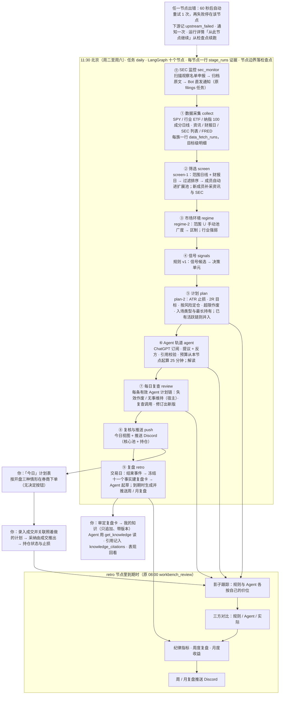

# 系统架构

> 版本 v2.9.0（2026-10-30）。只做美股；系统出计划，人决定是否下单，不接券商、不自动下单。
> 本文写到模块级。每个功能怎么用、怎么验证见 `features/`；怎么运行和维护见 `operations/`。

---

## 1. 运行形态：一个进程 + 一个数据库

```
macOS LaunchAgent（local.investment-assistant，登录时启动，KeepAlive）
  └─ start.command → scripts/start_local.py → uvicorn 127.0.0.1:8787（单进程）
       ├─ FastAPI：/api/*（OpenAPI 在 /docs）
       ├─ 静态前端：web/dist（Svelte 5，单页应用）
       └─ 调度线程：每 60 秒轮询 scheduled_jobs，到点运行已注册任务
PostgreSQL：唯一的状态存储（调度、运行报告、行情、计划、成交、复盘）
```

外部依赖与缺失时的行为：

| 依赖 | 用途 | 缺失或失败时 |
| --- | --- | --- |
| yfinance | 日线、资讯标题、下次财报日 | 单个目标失败（连接 10 秒、总 30 秒，重试 2 次）只记入该目标的拉取明细与运行报告 `summary.sources`，不写库、不冒充「无信号」 |
| SEC EDGAR（`SEC_USER_AGENT`） | 8-K/10-Q/10-K 列表与下载、SEC 监控 | 列表失败记入运行报告；缺 `SEC_USER_AGENT` 时下载返回空 |
| FRED（`FRED_API_KEY`） | HY 信用利差、2s10s | 未配置记「未配置」，不发请求 |
| ChatGPT 订阅（Sign in with ChatGPT，在「设置 → Agent 连接」登录一次） | Agent 轨道与每日复查的模型调用 | 未连接或连接失效时 `agent`、`review` 整个节点跳过并通知一次，额度用尽时其余单元跳过；规则计划与推送照常 |
| Discord | 每日计划推送、周/月复盘推送、SEC 监控通知、工作流失败与连接失效通知 | 推送失败写入运行报告，下次推送附「上次推送失败」；推送只在没发出去和被限流时重试，不重发 |
| PostgreSQL（`INVESTMENT_ASSISTANT_DATABASE_URL`） | 全部状态 | 大多数接口返回 `degraded` 或 503，调度线程不启动 |

---

## 2. 代码分层

```
api/routes/*      HTTP 薄封装：解析参数、映射错误码，不写业务逻辑
   ↓
services/*、workbench/service.py、workbench/plan_review.py      事务与用例
   ↓
workbench/repository.py、us_research/repository.py、db.py      SQL（调用方管理事务）
tasks/*           定时任务入口：tasks/daily.py 自带外壳（锁、检查点、运行报告、失败通知），其余走 tasks/_harness.py（run_id、运行报告、通知）
```

工作台的规则、计划、影子跟踪、纪律、月度收益和三方对比都写成**纯函数**（输入是截止时间之前的数据，输出是记录），离线测试不需要数据库。

### 主线模块（v2 工作台）

| 模块 | 做什么 | 依赖 |
| --- | --- | --- |
| `workbench/service.py` | 各节点的阶段函数（采集、筛选、环境、规则、计划、Agent、每日复查、推送、复盘；`sec_monitor` 在 `tasks/filings.py`）、`run_batch` 薄壳（v2.7 的单进程批处理，供测试与旧调用）与全部用例（含 `rerun_agent`；v2.9 起 `decide` 抛 `Gone`（410），`today` 的单元卡退役、单元卡数据只剩推送用的 `unit_cards`，读视图按 `timeline-2` 取链状态） | 下列模块、`repository` |
| `workbench/repository.py` | 工作台全部 SQL，只追加 | `db.py` |
| `workbench/bars.py`、`news.py`、`earnings.py`、`macro.py` | 采集：日线、资讯标题、财报日、FRED | yfinance、SEC、FRED |
| `workbench/universe.py`、`screen.py` | 纳指 100 范围文件；`screen-1` 过滤、排序、成员轮换（纯函数） | 纯函数 |
| `workbench/screening.py` | 筛选阶段编排：采集范围日线、写 `screen_runs` / `screen_results`、成员并池 | `service`、`repository` |
| `workbench/collect.py` | 共用逐只采集函数（批处理、筛选与「数据」菜单手动拉取共用）、`Tally` 记账与每族 advisory lock | `service`、采集模块 |
| `workbench/stages.py` | 十个节点注册表（`stages-4`，`STAGES` 与 `STAGE_IDS`；`stages-1` 到 `stages-3` 是历史版本，只给旧运行的展示用，不再写入）与 `StageRecorder`：每个节点一行 `stage_runs` 证据（计数、原因、产出引用、`attempt`、真实起止耗时） | `families`、`collect`、`repository` |
| `workbench/families.py` | 六个数据族注册表：用途、状态判定、原因脱敏、覆盖口径、目标清单（目标清单读数据库与范围文件，其余为纯函数） | `repository`、`pool`、`universe` |
| `workbench/pool.py`、`regime.py` | 观察池分层与来源；范围 ∪ 手动池的广度、区制、行业强弱 | 纯函数 |
| `workbench/rules.py`、`synthesis.py` | 规则 v1 候选；合成每股每日一个决策单元 | 纯函数 |
| `workbench/plans.py` | ATR、计划价位、有效期、财报提示、按风险定仓；`plan-2`（价位同 `plan-1`，加 `entry_type`、`max_hold_sessions`） | 纯函数 |
| `workbench/derivation.py` | 计划推导链（`derivation-1`）：按代入值独立重算 `plan-1` 规则计划的每一步（TR、ATR、价位、有效期、财报与环境提示、定仓、状态），与已存值逐项比对，给出 `consistent` / `mismatch` / `incomplete`；自定计划（价位为用户输入）与 Agent 计划（价位核对 `agent_runs.output.levels`）按入场区间中点定仓；触发段 `derive_trigger` / `derive_unit` 按 `CONDITIONS` 逐句复核候选冻结的取值（`holds` / `violated` / `not_frozen`，`violated` 计入不一致）；常量与 `plans.py` 分开声明、由测试对齐；不调用 `plans.py` 的计算函数 | 纯函数（只依赖交易日历） |
| `workbench/derivation_view.py` | 推导与阶段证据的只读用例：`load_rows` 只按计划 `inputs` 里的 id 回读日线、财报日、快照、区制、Agent 运行与规则计划（都是只追加的表，读到的就是生成时那一行）；`plan_derivation`（推导 + `trigger_note` + 运行证据 `run`，运行证据取插入该计划的 `plan` / `agent` 阶段行）、`unit_derivation`（只有触发段 + 该单元计划 id）、`stage_runs_view`（按 `run_id` 分组、按注册表排序）、`check_plans`（批处理用，同一只读事务里批量推导）；全部在 `service.read_only_tx()` 里执行，不调用外部数据源，缺行如实标 `incomplete` | `derivation`、`stages`、`repository`、`service` |
| `workbench/knowledge.py` | 版本化概念卡与「原理」页（v2.6，`knowledge-1`）：读 `docs/knowledge/` 的 Markdown 卡（YAML 头 + 正文），一次报出全部校验问题，用 `markdown-it-py` 渲染（关闭原始 HTML、卡内链接在 token 层改写），给 Agent 的纯文本，进程内缓存（失败不缓存）；知识接口、`get_concept` 与命令行 `check` / `show` 共用；纯文件读取，不碰数据库 | `markdown-it-py`、`PyYAML`、`stages`（阶段 id） |
| `workbench/labels.py` | 规则中文名（全称 `RULE_TEXT`、K 线标记用的简称 `RULE_SHORT`）与动作名；运行一览、「今天该关注什么」与 K 线标注共用，前端 `RULE_LABELS` 与之逐字对齐 | 无 |
| `workbench/workflow.py` | 每日工作流 `daily-1`（v2.8）：LangGraph 十个节点串成一条线（`sec_monitor` → `collect` → `screen` → `regime` → `signals` → `plan` → `agent` → `review` → `push` → `retro`），节点外壳 `node`（开记账、跑阶段函数、出错 60 秒后自动重试一次、写该节点唯一一行）、`PostgresSaver` 检查点（`thread_id = run_id`，节点边界同步落盘）、执行器 `run` / `resume`（失败节点之后写 `skipped / upstream_failed`）、续跑前置检查 `resume_check`（只读不写：失败的是检查点的 `next[0]`、截止是下一个交易日纽约 17:00）、有效行 `effective_rows` 与运行状态 `run_status`（失败 / 降级 / 成功） | `service`、`stages`、`agent/model`（检查点）、`collect` |
| `workbench/run_detail.py` | 运行详情只读用例（v2.8，`GET /api/runs/{run_id}/detail`）：全程在 `service.read_only_tx()` 里读 `job_reports`、`stage_runs`、`data_fetch_runs`、阶段证据指向的行与 `agent_attempt_resets`，检查点只读 `get_state(config).next`；句子、原因文案和 `headline` 复用 `run_overview`，运行状态与续跑条件复用 `workflow`；`results` 每类至多 200 项（`total` 为真实数）；不调用外部数据源，不碰 Agent 连接 | `run_overview`、`workflow`、`repository`、`service` |
| `workbench/run_overview.py` | 运行一览（v2.6）：只读 `stage_runs`，按模板拼每个阶段的一句话与原因文案（纯函数 `describe` / `build`，数字与行逐字段相同），选同日要显示的那次运行（跳过休市空跑）；只读用例 `overview`（`service.read_only_tx()`）与命令行 `python -m investment_assistant.workbench.run_overview` | `stages`、`labels`、`agent`（原因文案）、`repository`、`service` |
| `workbench/reasoning.py` | Agent 推理阅读视图（v2.6）：把一次 Agent 运行（`propose` / `revise` / `review` / `interpret`）按阅读步骤摊开——读了什么、提议、校验、反方、回应、生成的计划；`TOOL_CONCEPTS`（工具结果字段 → 概念卡）、`CHECKS`（校验项与作废原因）；纯函数 `build` 与只读用例 `reasoning`（同一只读事务里复用 `derivation_view` 的推导） | `agent/conditions`、`labels`、`derivation_view`、`repository`、`service` |
| `workbench/chart.py` | 「标的」页的 K 线数据：拆股调整日线（保留 250 根，MA20 / 50 / 200 用全部读到的历史算）；v2.6 起 `annotate`（纯函数）从已有表组装图上标注——候选信号日的箭头（同日多条合成一条，文字取 `labels.RULE_SHORT`）、每份计划在有效期与图上日期交集内的入场上沿 / 下沿 / 止损 / T1 四条短线段（有效期最近的 `MAX_PLANS = 12` 份，其余记 `omitted`）、你的未作废成交（落在纽约日期那根日线，非交易日落到之后最近一根），标记按时间升序 | `labels` |
| `workbench/instrument_view.py` | 「标的」页的纯函数（v2.6）：「今天该关注什么」`focus`（持仓 → 进行中的 Agent 计划 → 今日触发 → 临近财报）、`key_data`（与 Agent 工具同一个 `tools.indicators`，请求时现算不入库）、`context_view`（下次财报日、区制、行业强弱） | `agent/tools`、`reasoning`、`labels` |
| `workbench/agent/` | Agent 轨道：工具层（十个工具，含不受截止时间约束的 `get_concept` 与按截止时间读的 `get_knowledge`）、LangGraph 图（提议 + 反方 / 解读 / 复盘卡起草 / 讨论回答）、引用校验、模型接入（`model.py`：`AgentSettings`、`chat_model`、`SiwcChatOpenAI`、`classify_error`） | LangGraph、`chatgpt`、`agent_connection`、PostgresSaver |
| `workbench/agent/chatgpt.py` | Sign in with ChatGPT 协议（`siwc-1`，v2.8）：发现文档校验、授权 URL（PKCE、动态注册）、一次性回环回调监听、换令牌与刷新、撤销、模型清单、Responses 请求改写（`rewrite_payload`）、错误表；所有请求走 `fetch-1`，异常一律重建为只带安全码的 `ChatGPTError`，令牌不出这个模块的异常 | `data/fetch_policy` |
| `workbench/agent_connection.py` | ChatGPT 连接用例（v2.8）：开始 / 取消登录、回调完成、`access_token`（剩余不足 300 秒时在 `FOR UPDATE` 事务里先写库后使用）、断开、选模型、状态视图 `status_view`（只返回状态、脱敏邮箱、到期时间、模型，不含令牌 / `client_id` / `host_id` / `subject`）、`first_failure_since_ok`（失效通知每次失效只发一次）；**唯一读写 `agent_connections` 与 `agent_connection_events` 的模块**（`repository` 不出现这两张表） | `chatgpt`、`service`（连接） |
| `workbench/agent/conditions.py` | 失效条件与下次复查条件的注册表 `condition-2`（`condition-1` 的判定不变，加 `held_sessions_reached`）：参数校验、按事实判定 `met` / `not_met` / `unknown`（数据缺失不当作成立）、条件文案 | 纯函数（只依赖交易日历） |
| `workbench/agent/plan_check.py` | `agent-2` 计划、反证与复查结论的校验（论点条数、条件、修订 `changes` 与宿主差异、`user:<id>` 引用），宿主差异 `diff` | `citations`、`conditions` |
| `workbench/entry_rules.py` | 入场规则 `entry-1`（v2.9）：三种入场类型、开盘三种情形的做法与逐字文案 `scenarios`、本计划何时作废 `void_when`、影子用的 `simulate_entry` | 纯函数 |
| `workbench/execution.py` | 采纳由成交推导 `execution-1`（v2.9）：成交 → 计划 → 链的映射、链上买入 `chain_buys`、执行状态四种（`adopted` / `out_of_validity` / `pending` / `not_executed`）与链级 `executed`、计划外 | 纯函数 |
| `workbench/plan_views.py`、`plan_table.py` | v2.9 只读视图：`plan_table`（「今日」计划表：入场期 / 持仓 / 已结束三组、其他触发）、`plan_history`（「标的」页计划历史）、`holding_status_view`、`linkable_plans`；迁移 029 未执行抛 `NotReady`（503）；持仓缺行时现算并标 `stale`；`plan_table.py` 是命令行薄壳（`python -m investment_assistant.workbench.plan_table show --session D`） | `plan_review`、`execution`、`entry_rules`、`repository` |
| `workbench/timeline.py` | 计划时间线 `timeline-2`（`timeline-1` 保留给旧复查行）：九种链状态与每标的一条活跃链、版本有效期与版本计划行、「上次复查之后」窗口、八项系统信号（含 `retrigger`）、条件判定结果、宿主结论、持仓状态 `holding_status`、「同标的上一条链」证据块、复查与修订提示词的证据块 | 纯函数（复用 `plans` 的计算函数） |
| `workbench/plan_review.py` | 每日复查阶段 `review`：复查对象与排序、链标的（只采集不跑规则）、逐链复查 `review_chain`（全程在一条不经连接池的专用连接（autocommit，用完即关）上持会话级锁 `review-run:<标的>:<信号日>`；短事务持锁读取 → 无事务调模型 → 一个写事务写入复查运行、修订运行、新版计划与版本、复查记录）、阶段记账（含逐链 `detail.excluded`）与新版推导核对；重新复查（`recheck_check` 同步前置检查、`recheck` 后台执行，截止时间 = 请求时刻）；只读视图（链视图 `chain_view`、某日复查 `reviews_view`、标的的链列表 `ticker_chains`）；命令行 `python -m investment_assistant.workbench.plan_review chain / recheck / check` | `service`、`timeline`、`user_inputs`、`agent/`、`repository` |
| `workbench/user_inputs.py` | 用户输入（研报要点、新闻、你的判断、其他、撤回）：校验、按 `request_id` 幂等写入（只追加，更正与撤回指向旧行）、按标的 / 链列出并标记已更正 / 已撤回；只作为复查与修订提示词的证据 | `ledger`（`request_hash`）、`repository` |
| `workbench/agent/growth_check.py` | 复盘卡草稿、教训、讨论回答的校验（`check_draft` / `check_lesson` / `check_answer`，引用允许 `fact:` / `call:N` / `concept:` / `know:` / `user:`）与 `knowledge_citations` 抽取（只取通过校验后保留下来的字段） | `retro`、`agent/citations` |
| `workbench/agent/discuss_tools.py` | 就此计划讨论专用的三个只读工具（`get_plan_context`、`get_derivation`、`get_agent_run`）与 `DiscussContext`：只接受本单元的计划与运行，越界返回错误信封，不读任何草稿，不写任何表 | `reasoning`、`derivation_view`、`repository` |
| `workbench/retro.py` | 复盘卡的纯函数（`retro-2`，`retro-1` 的函数保留给旧卡）：结束事件 `end_event`（含检测窗口 `window_start`、`event_key`、平仓方式）、参考计划、冻结事实 `build_facts`（十个键 `FACT_KEYS`，`retro-2` 的 `build_facts_v2` 十一个键 `FACT_KEYS_V2`：`decision` 换成 `execution`，加 `holding`）、决定文案、纪律摘要、起草用的事实文本与卡状态 | `discipline`、`tracks`（只复用判定） |
| `workbench/retro_cards.py` | 复盘卡用例（v2.9 起对象由 `repository.retro_subject_keys` 给出：有关联成交、或你写过备注的链 / 单元，加计划外成交）：阶段 `run_stage`（只读事务检测 → 一个写事务建卡 → 每张卡一个写事务起草）、`detect` / `draft_card` / `redraft`、审定 `verdict`（草稿全部出现，一个事务写审定、决定与知识第 1 版）、列表与卡页视图（含 `discipline_now`）、命令行 `retro_cards detect / draft / show / check` | `service`、`retro`、`knowledge_items`、`my_knowledge`、`agent/graph`、`repository` |
| `workbench/knowledge_items.py` | 「我的知识」的纯函数（`my-knowledge-1`）：字段与挂靠校验、`know:` 引用解析、截止时间可见性 `visible`、改了哪些字段 | `knowledge`（概念 id 格式） |
| `workbench/my_knowledge.py` | 「我的知识」用例：写 / 改版 / 归档恢复（`base_version` 与 advisory lock、`request_id` 幂等）、列表与条目视图、表现回看 `performance`、讨论草稿的审定、`refs_for_plans`（计划卡与链视图的「引用的知识」）、命令行 `my_knowledge show / check-cutoff` | `service`、`knowledge_items`、`knowledge_perf`、`plan_shadow`、`repository` |
| `workbench/knowledge_perf.py` | 知识表现回看的纯函数（`knowledge-perf-1`）：每个单元取最早引用的一版，汇总复用 `review.shadow_block`，样本不足 5 个不给均值 | `review` |
| `workbench/discussion.py` | 就此计划讨论用例（`agent-discuss-1`）：建讨论、提问的同步检查（前置检查与你的这一轮）、后台回答 `answer`（模型没有写工具，宿主只写你的一轮、回答、运行与工具调用、可选的一条经验草稿）、讨论视图（`pending` / `interrupted` 在读取时判定） | `service`、`agent/graph`、`discuss_tools`、`my_knowledge`、`repository` |
| `workbench/briefs.py` | 由 Agent 运行构造决策单元的解读 | 纯函数 |
| `workbench/ledger.py`、`positions.py`、`exits.py`、`account.py` | 成交与备注（只追加）、FIFO 持仓、持仓止损、资金快照与出入金。v2.9 起 `ledger.record_trade` 接受 `plan_id` / `own_plan`（关联成交时刻的链头，自定计划与成交同一事务，R6 / R12）并拒绝 `decision_id`，`record_note` 写 `plan_notes`；决定的记录函数已删除，`signal_decisions` 只读 | 纯函数 + SQL |
| `workbench/plan_shadow.py`、`review.py`、`discipline.py`、`tracks.py`、`monthly.py`、`backcheck.py` | 影子跟踪（`plan-shadow-2` 带反事实的 `simulate_both`）、周度复盘（`review-8`）、纪律（`discipline-2`）、三方对比（`tracks-2`）、月度收益与敏感性（`monthly-4`）、上线前检查 | 纯函数 |
| `workbench/digest.py`、`review_digest.py` | 每日推送与周/月复盘推送的数据 | 纯函数 |
| `workbench/data_view.py` | 「数据」菜单用例：总览 / 详情 / 浏览（只读事务）与单族手动拉取，写 `data_fetch_runs` | `families`、`collect`、`repository`、`runner` |
| `tasks/daily.py` | 唯一的定时任务外壳（v2.8）：`daily:run` 会话级 advisory lock（定时 / 手动 / 续跑 / SEC 回补共用，`is_running()` 只看不取）、调 `workflow.run` / `resume`、每次执行追加一行 `job_reports`（`task = 'daily'`）、失败通知（每次执行至多一条）与连接失效通知（见下，每次失效只发一次）、命令行 `run / resume / show` | `workflow`、`service`、`notify/` |
| `tasks/filings.py` | `sec_monitor` 节点的阶段函数与 SEC 回补 `backfill`（任务 `sec_backfill`，只手动，与 `daily` 共用锁）；CLI 改为按日期回补 | `daily`、`filings/` |

### 共享底座

| 模块 | 做什么 |
| --- | --- |
| `api/` | FastAPI 应用、Basic 认证、静态文件、路由 |
| `tasks/scheduler.py`、`tasks/_harness.py`、`tasks/runner.py`、`tasks/run_log.py` | 调度线程、任务外壳、手动运行的后台执行、运行日志（JSONL） |
| `notify/` | Discord（webhook 与 Bot）与邮件渠道、消息模板（含 v2.8 的「每日工作流失败」`daily_failed` 与「ChatGPT 连接已失效」`agent_not_connected`） |
| `filings/` | SEC 下载器与 SEC 监控（正文事实、来源报告、历史去重） |
| `data/` | 交易日历、外部请求策略 `fetch-1`（`fetch_policy.py`：连接 10 秒 / 总 30 秒、重试 2 次、`FetchError` 分类与逐次尝试记录、yfinance 两层截止；`http.py` 的 `get_json` 经它）、美股代码校验（`identity.py`） |
| `services/watchlist.py`、`settings.py`、`jobs.py`、`status.py`、`health.py` | 观察名单（只认美股代码）、通知设置、任务与运行报告（`jobs.trigger_job` 手动运行 `daily` / `sec_backfill`，`jobs.resume_daily` 做续跑前置检查并提交后台续跑）、系统状态 |
| `db.py`、`migrate.py`、`config.py` | 连接池与通用 SQL、迁移入口、配置加载 |

### 主线 · 基本面

| 模块 | 做什么 |
| --- | --- |
| `us_research/` | 美股财季数据与指引（「标的 → 基本面」、SEC 任务后的本地刷新） |

---

## 3. 主线数据流



时点纪律：规则、计划和 Agent 工具只读运行截止时间之前已入库的数据；所有业务记录只追加，更正用新记录指向旧记录。手动运行不推送。

十个节点（`sec_monitor`、`collect`、`screen`、`regime`、`signals`、`plan`、`agent`、`review`、`push`、`retro`）按 `workbench/stages.py` 注册表（`stages-4`）的定义展示，每次运行每节点向 `stage_runs` 追加一行证据（计数、原因、产出引用、`attempt`、耗时）；历史上的 `stages-1` 到 `stages-3`（七、八、九个阶段，`retro` 在 `push` 之前，名叫「复盘卡」）只用于展示旧运行。续跑只给重新执行的节点追加 `attempt + 1` 的行，已完成的节点保持 `attempt 1`，「十行」读作每个节点的有效行（最大 `attempt`）共十条。`review` 只复查已有的 `agent-2` 链；`retro` 只对你参与过的单元与你的成交建卡，检测、建卡、起草分三类事务，Agent 不可用时照常建卡；链的标的若已离开观察池与持仓，只在采集节点补采数据，不进规则循环。`collect` 采集纳指 100 成分日线并交给 `screen`，筛选后新成员的资讯与 SEC 在 `screen` 节点补采；信号与计划在同一个逐只循环里交替执行；展示顺序以注册表为准，不以时间戳为准。

每个节点结束时整条链的状态同步写进检查点（`thread_id = run_id`，与 Agent 子图共用同一组检查点表），所以失败可以从那里接着跑；运行状态由有效行推出（有 `failed` 为失败，否则有 `partial` / `degraded` 为降级，否则成功），失败时发「每日工作流失败」通知一次。ChatGPT 连接失效使 `agent` / `review` 跳过时，执行收尾再发一条「ChatGPT 连接已失效」，同一次失效只通知一次。

运行详情（`#tools/runs/<run_id>`）读 `run_detail.detail`：节点状态图、每个节点做了什么、拉取详情和结果详情，失败的节点上有「从此节点继续」（`POST /api/jobs/daily/resume`：前置检查同步做、不写任何行，通过后后台续跑），Agent 单元上有「重新运行 Agent」（`POST /api/workbench/agent-runs/rerun`：写一行 `agent_attempt_resets` 重置尝试次数闸）。

---

## 4. 数据表分组

| 组 | 表 |
| --- | --- |
| 共享底座 | `watchlist_items`、`scheduled_jobs`、`job_reports`、`notify_settings`、`filings` |
| 数据底座 | `data_fetch_runs`（迁移 024，只追加：每次拉取一行成败与目标级明细 `detail.targets`，每日工作流、`sec_backfill` 与「数据」菜单共用）、`stage_runs`（迁移 025，只追加：每次运行每节点一行证据，含计数、原因、产出引用与耗时；迁移 028 起有 `attempt`，唯一键 `(run_id, stage, attempt)`，`job` 可为 `daily`） |
| 工作台 · 采集 | `price_bars`、`news_items`、`news_item_tickers`、`earnings_dates`、`macro_observations` |
| 工作台 · 信号与筛选 | `signal_candidates`、`signal_briefs`、`pool_tiers`（含 `source`）、`market_regimes`、`screen_runs`、`screen_results` |
| 工作台 · 计划与执行 | `trade_plans`（迁移 029 起有 `entry_type`、`max_hold_sessions`）、`signal_decisions`（v2.9 起只读，不再写入）、`trades`（迁移 029 起有 `plan_id`，与旧 `decision_id` 不并存）、`account_snapshots`、`cash_flows` |
| 工作台 · 可执行的计划（迁移 029） | `chain_retriggers`（再次触发并入哪条链）、`holding_status`（每个持仓标的每个复查交易日一行）、`plan_notes`（给自己看的备注，可更正 / 撤回）——三张只追加的表，不在 `WORKBENCH_TABLES` 里，缺表时按 `repository.executable_ready` 判定、读视图返回 503、`daily` 拒绝运行 |
| 工作台 · Agent | `agent_runs`、`agent_tool_calls`；LangGraph 检查点表由 `python -m investment_assistant.workbench.agent setup` 创建，不在迁移里（Agent 子图的 `thread_id` 是 `agent_runs.id`，每日工作流的是 `daily-…` 运行编号，两者共用同一组表） |
| 每日工作流（迁移 028） | `agent_connections`（单行：ChatGPT 连接状态、**明文令牌**、`client_id`、`host_id`，是机密，进数据库备份时按机密处理）、`agent_connection_events`（只追加：登录、续期、失败、断开、选模型，只放安全码与到期时间，绝不放令牌）——两张表只由 `workbench/agent_connection.py` 读写；`agent_attempt_resets`（只追加：「重新运行 Agent」重置尝试次数闸，`repository` 对它只有 `INSERT` / `SELECT`，`request_id` 幂等）；三张新表都不在 `WORKBENCH_TABLES` 里；同一迁移给 `stage_runs` 加 `attempt`、把 `scheduled_jobs` 的三个任务换成 `daily` |
| 工作台 · 计划时间线 | `agent_plan_versions`（每版 Agent 计划一行，链关系与截止时间）、`plan_reviews`（每次复查一行：信号、条件判定、结论、新版）、`user_inputs`（你贴入的材料，更正与撤回指向旧行）；迁移 026，只追加，不在 `WORKBENCH_TABLES` 里，缺表时按 `timeline_ready` 降级 |
| 成长闭环 | `review_cards`（复盘卡，冻结事实，`event_key` 唯一）、`review_card_drafts`（每次起草一行，每卡至多一份成功草稿）、`review_card_verdicts`（一卡一审定）、`discussions`、`discussion_turns`（就此计划讨论）、`knowledge_items`、`knowledge_versions`、`knowledge_status`（我的知识：版本连续不分叉，归档是状态记录）、`knowledge_drafts`、`knowledge_draft_verdicts`（教训草稿及其决定，一稿一决定）、`knowledge_citations`（计划与复查引用了哪一版知识）；迁移 027，十一张都只追加（`repository` 对它们只有 `INSERT` / `SELECT`），不在 `WORKBENCH_TABLES` 里，缺表时按 `growth_ready` 降级 |
| 工作台 · 复盘 | `weekly_reviews`、`monthly_reviews`、`rule_backchecks`、`review_pushes` |
| 主线 · 基本面 | `us_research_observations`、`us_research_collection_state`（`us_research/`；迁移 022 删除 v1 遗留的 6 张表，见 operations） |

迁移清单与执行方式见 [operations/migrations-and-backup.md](operations/migrations-and-backup.md)。

---

## 5. 定时任务与前端

| 任务 | 默认时间（迁移种子） | 组 |
| --- | --- | --- |
| `daily` | 北京 11:30，周二至周六（`Asia/Shanghai`；迁移 028 沿用旧 `workbench` 行的开关） | 主线 |
| `sec_backfill` | 只手动（不在 `scheduled_jobs`，调度器从不执行它），必须带日期 | 共享 |

旧任务 `workbench`、`workbench_review`、`filings` 已并入 `daily`（SEC 监控是第一个节点，周 / 月复盘在最后一个节点），代码与调度行都已删除；`job_reports.task` 里它们的历史值保留只读。服务仍只有一个 LaunchAgent，`daily` 由 API 进程内的调度线程执行，plist 不需要改。

调度细节见 [operations/scheduling-and-notifications.md](operations/scheduling-and-notifications.md)。

前端（`web/`，Svelte 5）：主线入口是「今日」「标的」（K 线图与基本面）「复盘」（交易与持仓、对照组、周度、月度、资金、轨道对比、上线前检查）；「数据」展示六族状态、族详情与原始值表格；「更多」下是共享底座的「工具」（任务中心、运行记录、SEC 文件）与「设置」（系统、关注列表、推送、定时任务、环境变量）。计划推导整页地址 `#plan/<id>`（不进侧栏，「复盘」轨道对比里的计划链接指向它；无 id 回落「今日」）。旧地址（#technicals、#strategy、#trade）回落到「今日」。

v2.5 起，「今日」默认「Agent 优先」：Agent 计划块（`components/AgentPlanCard.svelte`，「今日」与计划页共用）在前，规则基线（`components/RuleBaseline.svelte`）折叠为一行，页头可切回 v2.4 的「规则优先（旧）」布局（存浏览器本地）；单元列表之后是「进行中的 Agent 计划」。`agent-2` 计划的 `#plan/<id>` 在推导之上另有版本链与复查记录（`components/PlanTimeline.svelte`：每版来源、生成与截止时间、价位、宿主差异、影子状态，点开即该版的 Agent 计划块；打开旧版时页头标「这是第 k 版，最新为第 n 版」并链接最新版；链在入场期或持仓期时可「重新复查」，最长轮询 `/api/runs/<run_id>` 900 秒，超时提示「复查仍在后台进行，稍后刷新查看」），以及作用于这条链的「我的补充」（`components/UserInputs.svelte`：类型、正文 1–4000 字、可选链接，提交带 `request_id`，失败保留草稿与 `request_id`；每条可更正或撤回，都是新一行指向旧行）。「标的」页尾新增「Agent 计划」（该标的全部链）与「我的补充」（作用于标的，可选一条入场期或持仓期的链），其余部分不动。链、版本、复查记录的类型与中文文案（结论、决定方、信号、来源、条件判定、条件文案模板 `conditionText`）集中在 `web/src/lib/timeline.ts`，`conditionText` 与后端 `agent/conditions.py` 的模板逐字一致；`workbench.ts` 的 `AGENT_REASON_TEXT` 与后端 `agent.REASON_TEXT` 同步。

v2.6 起，侧栏多一个「知识」菜单（路由 `#knowledge`，`routes/Knowledge.svelte`）：「概念」按七组浏览 105 张概念卡（v2.6 起 88 张，v2.7 增 7 张，v2.8 增 3 张，v2.9 增 7 张），`#knowledge/<id>` 看单张卡（卡的 HTML 由后端渲染，前端只在这一页用 `{@html}`）；「原理」是 `docs/knowledge/principles.md` 的分节页。数据来自只读的 `/api/knowledge/*`，不依赖数据库。三个新组件：`ConceptTerm`（文字加虚线下划线与「ⓘ」按钮，点开原位展开卡标题 · 摘要 · `concept:<id>@<version>` ·「看完整卡」，同一页同时只展开一个，`Esc` 收起；概念索引由 `lib/knowledge.ts` 的 `conceptIndex()` 每个页面会话只请求一次，知识接口 503 时按钮保留、框里写「概念卡暂不可用：<原因>」）、`RunOverview`（「今日」顶部的运行一览：每个阶段一句话、状态徽标、跳过 / 失败 / 降级明细与相关概念，数据来自 `/api/workbench/run-overview`）、`AgentReasoning`（Agent 推理阅读视图：从计划卡与版本链的「看推理过程」进入，按步骤摊开证据、读了什么、提议、校验、反方、回应与结果，工具结果字段逐个挂概念，数据来自 `/api/workbench/agent-runs/{run_id}/reasoning`）。页面字段挂哪张卡集中写在 `lib/knowledge.ts` 的 `ATTACH`（另有 `familyConcept` / `ruleConcept` / `derivationStepConcept`），模板里不写字面概念 id；`tests/test_knowledge_attachments.py` 检查这些 id 都有卡、前端 `RULE_LABELS` 与后端 `labels.RULE_TEXT` 一致、`derivation.py` 的步骤 `key` 都按规则覆盖。「标的」页重排为四段：①信号与计划（`focus` 今天该关注什么：持仓 → 进行中的 Agent 计划 → 今日触发 → 财报；今日触发、进行中的 Agent 计划与「我的补充」，持仓行带当前止损 / T1）、②关键数据（`key_data`：最近收盘与指标，每项挂概念）、③背景（财报日、区制、行业强弱、基本面、资讯与 SEC）、④历史（K 线、计划价位列表、候选 / 决定 / 成交时间线），某块读取失败时对应段里显示 `errors` 给的原因；K 线图（`CandleChart`）按 `annotations` 叠加标记（触发候选、成交）与计划价位线段（入场区间、止损、T1，最多 12 份计划，作废的计划淡显）。

v2.7 起，前端多出成长闭环的三块（类型、文案、接口封装、跨语言要对齐的常量集中在 `lib/growth.ts`；接口调用在 `lib/api.ts`，缺表 503「迁移 027 未执行」时各处显示降级说明）：①「复盘」页新增「复盘卡」页签（`#review/cards`、`#review/cards/<id>`，`ReviewCardList`、`ReviewCard`、`CardVerdictForm`；路由对 `review`、`knowledge` 保留第一段之后的路径；待审定卡数显示在页签角标上）：卡页按冻结事实、三轨道的 R、你的决定与纪律（另列「现在的判定」）、Agent 起草的叙述与教训草稿展开，教训在 `CardVerdictForm` 里逐条采纳（可改全部字段）、不采纳或另写，一次提交；事实已变化、起草失败、起草中分别有提示；周度复盘新增「你学到了什么」一段（纪律四项、本周复盘卡链接、本周被检验的知识）。②「知识」菜单的「我的知识」（`#knowledge/mine`、`mine/new`、`mine/drafts`、`mine/<id>[@<版本>]`，`KnowledgeList`、`KnowledgeItem`、`KnowledgeForm`、`KnowledgePerformance`）：写 / 改 / 归档、版本列表（可看旧版）、挂靠的概念与标的、引用它的计划版本与表现回看（样本量常驻，少于 5 个不给均值）、待审定的教训草稿；「标的」页另有挂在该标的上的知识。计划卡与推理阅读视图里的「引用的知识」由 `KnowledgeRefs` 显示（`know:<id>@<版本>` 链到那一版，之后有新版时注明当前版本），`RefList` 把回答与草稿里的 `fact:` / `call:` / `concept:` / `know:` / `user:` 引用渲染成可点开的链接。③「就此计划讨论」：`DiscussButton`（挂在计划卡、计划页、「标的」页的计划行与复盘卡上）新建或打开讨论，讨论页是独立路由 `#discuss/<id>`（`Discussion`；无 id 或 id 不是数字回落「今日」）：提问后每 `DISCUSS_POLL_INTERVAL_MS`（2 秒）轮询回答，最长 `DISCUSS_POLL_MS`（600 秒），超时写「回答仍在后台生成，稍后刷新查看」；输入框可附上一条知识或一份草稿作为「就这条改写」的材料，每个已写入的用户轮次上有「存为补充信息」（`request_id` 由前端按 `uuid5(NAMESPACE_URL, 'discussion-turn:<轮次 request_id>')` 派生，与后端 `discussion.user_input_request_id` 逐字一致，由 `tests/test_growth_frontend_sync.py` 固定），回答带出的经验草稿显示在回答下（改写草稿注明目标条目与版本），在「我的知识」的草稿队列里审定。`tests/test_growth_frontend_sync.py` 还核对结束类型、状态、决定文案与 `AGENT_REASON_TEXT` 的新六项与后端逐字相同；`tests/test_knowledge_attachments.py` 核对 v2.7 新增的挂靠分组（`retroCard`、`myKnowledge`、`discussion`、`weeklyLearning`）里的概念 id 都有卡。

v2.8 起，前端多出运行详情与 Agent 连接两块（类型、中文文案与小函数集中在 `lib/runs.ts`；接口封装在 `lib/api.ts`，失败的 409 / 502 一律读响应体 `{"error": "<代码>"}`，文案在前端）。①**运行详情页** `#tools/runs/<run_id>`（`routes/Tools.svelte` 的 `sub` 为 `runs/<id>` 时渲染 `components/RunDetail.svelte`；`run_id` 必须匹配 `RUN_ID_RE`，否则回落「运行记录」列表，侧栏「运行记录」在详情页上同样高亮）：顶部一句话（`headline`）、元信息与执行记录（同一次运行的多次执行：定时 / 手动 / 续跑），`components/NodeGraph.svelte` 画十个节点的状态图（成功 / 降级 / 部分成功 / 失败 / 跳过 / 未开始 / 运行中，窄屏折行，运行中的节点边框闪烁），选中节点后分三块——「做了什么」（一句话、计数、原因、自动重试、`attempt`）、「拉取详情」（`components/FetchTable.svelte`：按族列出目标，失败的目标排在前面，目标明细被截断时注明「共 N 个目标，明细只记录了前 M 个」；旧运行没有目标明细时标「旧版本运行」）、「结果详情」（每类至多 200 项：`sec_monitor` 的申报、`signals` 的候选、`agent` 的单元、`review`、`push`、`retro` 的复盘卡与周 / 月复盘，链接到各自页面；`retro` 的状态与推送结果由代码译成中文：待审定 / 起草中 / 起草失败 / 已审定、已生成 / 沿用已冻结快照 / 已推送过 / 已提醒、已推送 / 手动运行不推送 / 未发送）；失败的节点上有「从此节点继续」（确认框 → `POST /api/jobs/daily/resume`；不能续跑时写明原因，`RESUME_ERROR_TEXT` 覆盖 `not_failed`、`node_mismatch`、`resume_window_closed`、`daily_running`、`interrupted`、`checkpoint_unavailable`），`agent` 节点上被 `max_attempts` 或出错挡住的单元有「重新运行 Agent」（`POST /api/workbench/agent-runs/rerun`，同步执行，成功写「已重置尝试次数，并已重新运行」，`origin` 为 `run_detail`）；运行中每 5 秒（`RESUME_POLL_MS`）读一次 `GET /api/runs/{run_id}/detail`，续跑后最长 60 分钟，之后写「未看到续跑开始，请稍后刷新」。全部文本按纯文本显示，没有新增 `{@html}`；旧 JSON 弹窗已删除，「运行记录」的「详情」改为链接，「今日」的运行一览标题旁多一个「运行详情」链接（`components/RunOverview.svelte`）。②**任务中心**（`routes/Tools.svelte`）：任务筛选加 `daily`、`sec_backfill`，旧任务名（`workbench`、`workbench_review`、`filings`）带「（v2.7 及以前）」；`daily` 行「立即运行」调 `POST /api/jobs/daily/run`，成功后给出「运行详情」链接，409 `daily_running` 写「每日工作流正在运行」；`sec_backfill` 是只手动行（接口给 `manual_only: true`，计划与状态列写「只手动」，没有「立即运行」和启停），只有「按日期运行」。「设置 → 定时任务」同样不给只手动行时间与启停。③**Agent 连接**（`components/AgentConnection.svelte`，放在 `#settings/system` 页「系统」之下）：未连接显示「连接 ChatGPT」，点后打开接口给出的 `authorize_url`（新标签页，`noopener`），登录中每 2 秒（`LOGIN_POLL_MS`）读 `GET /api/settings/agent-connection`，最长 10 分钟，可取消；已连接显示脱敏邮箱、所选模型下拉（`GET .../models`、`PUT .../model`，保存失败时回到当前模型）、令牌有效期与「断开」；需要重新登录时给出原因。全部写操作带 `request_id`。④**计划页**（`routes/Plan.svelte`）：Agent 运行为 `max_attempts` 或出错时显示「重新运行 Agent」（`origin` 为 `plan_page`）；`lib/workbench.ts` 的 `AGENT_REASON_TEXT` 加 `not_connected`「ChatGPT 未连接」、`model_unavailable`「所选模型不可用」。`tests/test_daily_frontend_sync.py` 固定三处要与后端逐字对齐的内容：`AGENT_REASON_TEXT` ⊇ `agent.REASON_TEXT`、`RESUME_ERROR_TEXT` 的键 = 续跑拒绝码、`RUN_ID_RE` 与后端同一模式。

v2.9 起，「今日」与「标的」的计划部分改成表格，决定按钮整体退役（类型、中文文案与小函数集中在 `lib/workbench.ts` 与 `lib/timeline.ts`，v2.9 的逐字文案由 `tests/test_executable_frontend_sync.py` 与后端对齐）。①「今日」的**计划表**（`routes/Today.svelte` 自己取数 `GET /api/workbench/plan-table`，可选交易日与「显示扩展池」开关，扩展池开关只作用于入场期与已结束两组，持仓永远列出；`components/PlanTable.svelte`）：入场期（可执行）、持仓中、已结束三组，已结束默认收起并置灰（展开状态存浏览器本地 `workbench.today.ended_open`），窄屏（< 900px）每行折成卡片；入场期行给入场类型、区间 L–U、止损、T1、仓位、有效期与「开盘三种情形」各做什么，持仓行给持仓状态一行（距止损、距 T1、已持有与剩余天数、指令与维持理由，当天没有写入时标「今日持仓状态未写入（每日复查失败），以下为现算」），行尾是由成交推出的执行状态（已采纳 / 有效期外成交 / 等待成交 / 未执行 / 已执行，并写明照 Agent 第 n 版、规则基线或自定）；点开一行（`components/PlanRowDetail.svelte`）看本计划何时作废、规则基线的一行 `plan-2` 摘要与推导、再次触发与最近的复查结论，并可写备注（`components/PlanNotes.svelte`，1–1000 字，带 `request_id`，只给自己看）；没有链的触发放在「其他触发」。表上没有任何决定按钮，`Today` 也不再读 `/today` 的单元、持仓与链。②「标的」页多一段**计划历史**（`components/PlanHistoryTable.svelte`，`GET /instruments/{ticker}/plan-history`）：该标的每条链的每一版一行（入场类型、区间、止损、T1、最长持有、与上一版的差异、再次触发标记、执行状态），可勾选带出复查记录与规则基线行。③「复盘」的**成交录入**（`routes/Review.svelte`）：「关联计划」下拉取自 `GET /trades/linkable-plans`（成交那一刻的链头、有效期覆盖成交日的规则基线、最近的自定计划，退出期的链不列），也可选「自定」（四个价位，成交同一事务里写成自定计划）或「无计划」；代码或成交时间变了就清掉之前的选择；成交列表显示关联的计划；`decision_id` 不再发送，旧决定的成交显示「旧决定」。④**计划页**（`#plan/<id>`）：版本链每版多出入场类型、最长持有、执行状态三项（并在同一行显示，不另设三列）；再次触发并入的单元、退出期与 `holding_status` 的历史、作废原因文案（`stop_above_close`、`chain_exiting` 等）、备注区；`AgentPlanCard` 标出持仓期不适用的入场区间。⑤**复盘卡与周 / 月复盘**：`retro-2` 卡显示「你的执行与纪律」（`facts.execution`、`facts.holding`；`retro-1` 的旧卡原样显示「你的决定与纪律」），周度与月度按 `review-8` / `monthly-4` 的新口径读 `execution_text`、`by_execution`、计划外成交与影子口径（`planKindText` 的 `FIRST_VERSION_CALCS` 含 `review-8` / `monthly-4`），对照组改为全部单元、不再有「决定」列；`review-7` 及更早的快照照旧显示。⑥错误与降级：迁移 029 未执行时各处写「迁移 029 未执行」（503），`POST /decisions` 的 410、带 `decision_id` 的 400、409 `plan_stale` / `plan_after_fill` / `chain_exiting` / `active_chain` 都按后端给的句子显示。已知缺口：备注没有更正 / 撤回的页面入口（接口已支持）。
